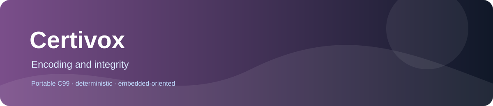

# Certivox
  



CRC profiles, streaming CRC helpers, Hamming codes and SECDED error correction/detection. CRCs and ECC do not provide cryptographic authentication or tamper protection.

## Why it exists

Embedded communication paths need bounded integrity and error-correction operations without dynamic allocation.

## What is included

- Portable C99-oriented implementation.
- Deterministic integer or fixed-point behavior documented at function level.
- No mandatory heap, threads or operating-system services.
- Separate translation units for selective linking.

## Quick start

```sh
cmake -S . -B build -DCERTIVOX_BUILD_TESTS=ON
cmake --build build --parallel
ctest --test-dir build --output-on-failure
```

For a minimal integration, include only the required public header and compile the matching source unit. The library does not require the rest of PrimitiveCore.

## Documentation

| Need | Read |
|---|---|
| Choose a primitive | [Family guide](docs/FAMILY_GUIDE.md) |
| Check every function and contract | [API reference](docs/API_REFERENCE.md) |
| Reproduce tests and see validation limits | [Testing report](docs/TESTING.md) |
| Review design and dependencies | [Architecture](docs/ARCHITECTURE.md) |
| See measured or pending performance data | [Performance](docs/PERFORMANCE.md) |

## At a glance

The public surface consists of 14 headers and 14 callable API entries under include/. Implementations are in src/ and tests are in tests/. State, buffers and output ownership are explicit in each header contract.

The CMake test option is CERTIVOX_BUILD_TESTS. The library has no mandatory third-party dependency. Platform-specific link requirements are documented in CMake and the affected API header.

## Validation status

All 14 public APIs have direct enabled tests. The audit differential suite adds 100,000 deterministic reference comparisons per applicable CRC operation and 100,000 full-width SECDED inputs. GCC, ClangCL and MSVC Debug/Release results, sanitizer status, historical hardware evidence and current hardware authorization limits are recorded in [docs/TESTING.md](docs/TESTING.md).

Current ESP32-S3 status for this audit: **HW NOT VERIFIED**. Historical ESP32-S3 reports are explicitly separated from current-source host results in [docs/PERFORMANCE.md](docs/PERFORMANCE.md). No CRC or ECC operation is a substitute for authenticated integrity protection.

Detailed overflow, rounding, invalid-input, memory-ownership and state rules are defined by the public headers and API reference. Do not infer them from the product name alone.

## License

Apache License 2.0, copyright Vanderhell. See [LICENSE](LICENSE) and [NOTICE](NOTICE).

## Origin

A standalone embedded-C library extracted from the PrimitiveCore product catalog. It is independently buildable and linkable.
